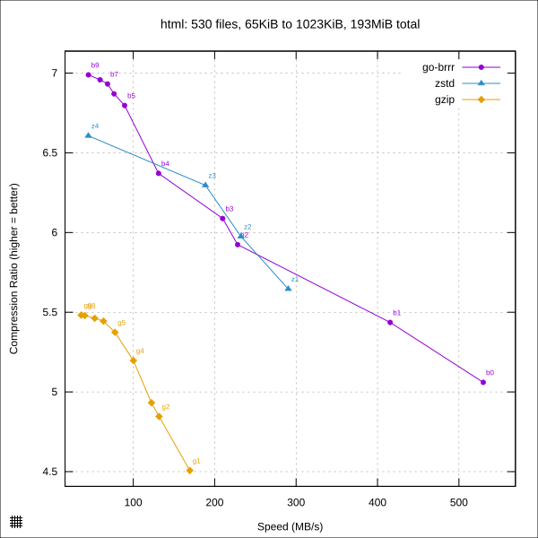
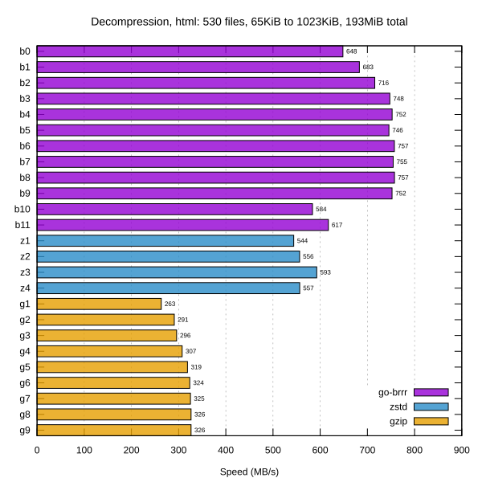
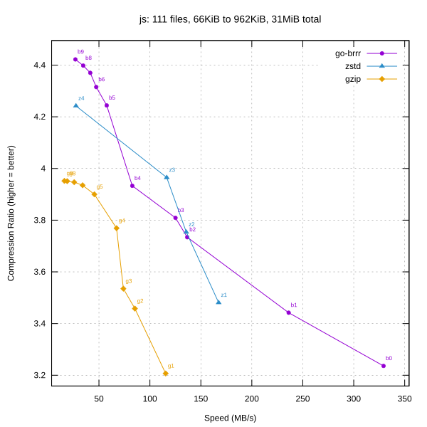
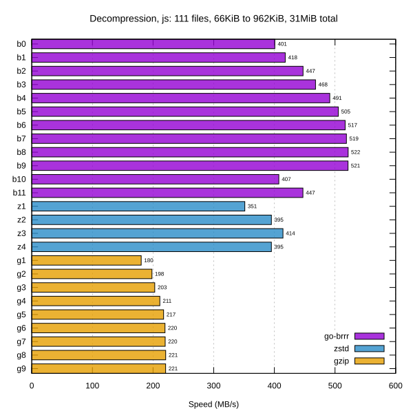
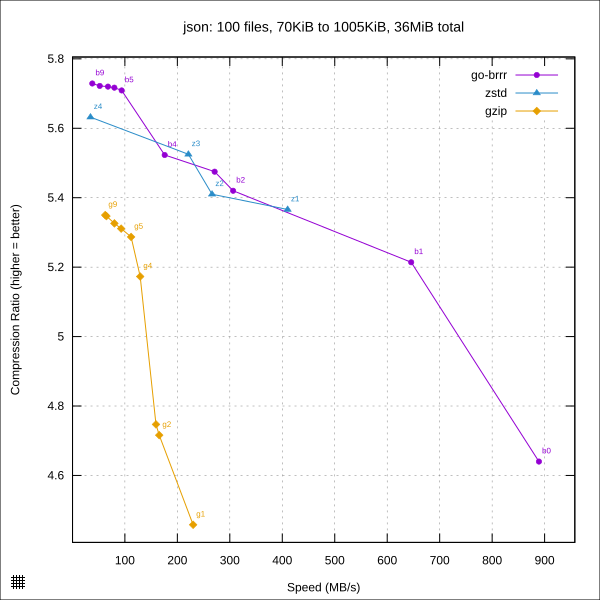
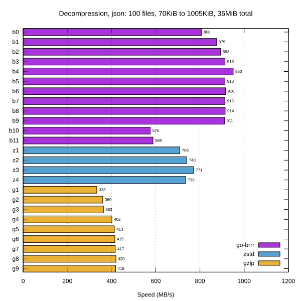
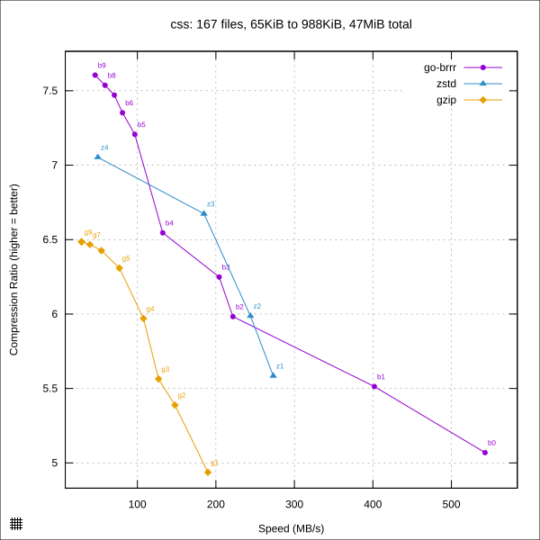
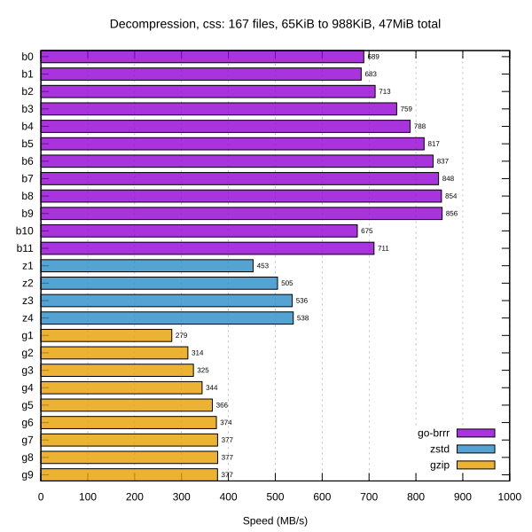
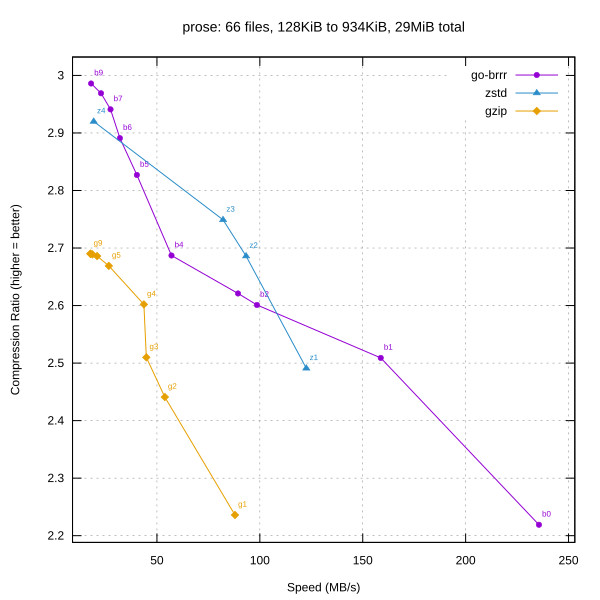
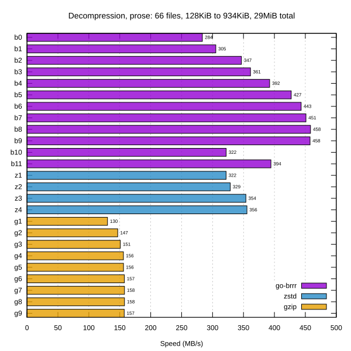

# go-brrr - Brotli compression for Go

[](https://github.com/molecule-man/go-brrr/actions/workflows/ci.yml)
[](https://pkg.go.dev/github.com/molecule-man/go-brrr)
[](https://goreportcard.com/report/github.com/molecule-man/go-brrr)
[](https://github.com/molecule-man/go-brrr/tags)
[](LICENSE)

Brotli compression library for Go (RFC 7932), with encoder and decoder support.

## Highlights

- **No C toolchain.** Builds with standard Go tooling.
- **Faster than other pure-Go brotli libraries** at every quality level we measure (see [Benchmarks](#benchmarks)).
- **Faster than CGO brotli** (cbrotli) in our benchmarks, for compression at q0-q11 and for one-shot decompression.
- **Compound dictionaries.**
- **Encoder tuning.** `LGWin` (window size) and `SizeHint` (expected total input size) are exposed via `WriterOptions`. `SizeHint` lets the encoder pick context modeling and hasher parameters tuned for the actual payload size.

## Status

The encoder and decoder are covered by compatibility tests and fuzzing. The public API is stable and follows semantic versioning.

## Compatibility

go-brrr implements Brotli RFC 7932 and is tested against the Brotli reference corpus. Encoded output is byte-compatible with the C reference implementation, release v1.2.1. One exception: with a compound dictionary at quality 3 and 4, go-brrr follows upstream commit [54f74c7](https://github.com/google/brotli/commit/54f74c7f5ac353100ebbda3d17f5471004f701b1), which is not in a release yet.

## Compared to other Go brotli libraries

| | go-brrr | [andybalholm](https://github.com/andybalholm/brotli) | [google/brotli/go/brotli](https://github.com/google/brotli/tree/master/go/brotli) | [cbrotli](https://github.com/google/brotli/tree/master/go/cbrotli) |
|---|---|---|---|---|
| Pure Go (no cgo) | ✓ | ✓ | ✓ | ✗ |
| Encoder | ✓ | ✓ | ✗ | ✓ |
| Decoder | ✓ | ✓ | ✓ | ✓ |
| Compound dictionaries (encode) | ✓ | ✗ | n/a | ✓ |
| Compound dictionaries (decode) | ✓ | ✗ | ✓ | ✓ |
| `LGWin` tuning | ✓ | ✓ | n/a | ✓ |
| `SizeHint` | ✓ | ✗ | n/a | ✗ |
| Writer `Reset` | ✓ | ✓ | n/a | ✗ |
| Reader `Reset` | ✓ | ✓ | ✗ | ✗ |

If you're using `andybalholm/brotli`, go-brrr is a near drop-in upgrade with higher throughput on both compression and decompression, plus compound-dictionary and `SizeHint` support. If you're using `cbrotli`, go-brrr gives up cgo, adds multi-chunk compound dictionaries, and exposes poolable `Writer`/`Reader` instances. `cbrotli` has no `Reset`, so each stream allocates a fresh encoder/decoder state, which is noticeable on many-small-file workloads.

## Install

```sh
go get github.com/molecule-man/go-brrr
```

```go
import "github.com/molecule-man/go-brrr"
```

The import path is `github.com/molecule-man/go-brrr`; the package name is `brrr`.

## Examples

### Compression

[embedmd]:# (example_test.go go /func Example_compress/ /^}/)
```go
func Example_compress() {
	input := []byte("Hello, brotli!")

	var compressed bytes.Buffer
	w, err := brrr.NewWriter(&compressed, 6)
	if err != nil {
		log.Fatal(err)
	}
	if _, err := w.Write(input); err != nil {
		log.Fatal(err)
	}
	if err := w.Close(); err != nil {
		log.Fatal(err)
	}
}
```

More examples are available in [example_test.go](example_test.go) and the [Go package docs](https://pkg.go.dev/github.com/molecule-man/go-brrr#pkg-examples): round-trip compression and decompression, one-shot decompression, reusing writers and readers, pooling, and compound dictionaries.

## When to use go-brrr

The best use case for brotli is **static asset compression** - CSS, JS, HTML, fonts, WASM - where you compress once at build time and serve the result millions of times. Use **quality 11** for this: speed doesn't matter because you pay the cost once, and brotli q11 delivers ratios that neither gzip nor zstd can match. Every browser shipped since 2016 supports `Content-Encoding: br`.

For on-the-fly compression, brotli q5–6 is a strong choice if you're already using zstd at its highest level: q5 is often **faster** with a **better ratio**, and q6 is only slightly slower with an even better ratio. At lower compression levels, zstd is significantly faster - if throughput is your priority and you don't need the best ratio, zstd is the better tool for the job.

If you compress or decompress repeatedly (e.g. per request in a webserver), keep `*brrr.Writer` and `*brrr.Reader` instances in `sync.Pool`s and `Reset` each one into the next stream rather than allocating new instances each time. See the [compiled examples](example_test.go).

## Implementation notes

go-brrr is optimized for throughput. Some hot paths intentionally use larger functions, duplicated loops, and specialized code where benchmarks showed measurable wins. These choices stay local to performance-sensitive encoder and decoder internals; public APIs stay small and conventional.

## Contributing

Contributions are welcome. Read [CONTRIBUTING.md](CONTRIBUTING.md) before you start.

The most important rules:

- **One pull request is one logical change.** Independent optimizations go into separate pull requests, so each one can be benchmarked, reverted, and bisected on its own.
- **Explain the expected effect and its cause.**

The maintainer measures every performance change against a file corpus on dedicated hardware.

For a large optimization, open an issue first and agree on the scope.

## Acknowledgments

This library is a port of the [Brotli reference implementation](https://github.com/google/brotli) by the Brotli Authors, licensed under the MIT License.

## Compression Speed vs Ratio

All benchmarks were taken on the following setup with turboboost, etc, being
disabled via [denoise-amd.sh](scripts/denoise-amd.sh):

```
goos: linux
goarch: amd64
cpu: AMD Ryzen 5 7535HS with Radeon Graphics
```

Each plot uses a set of real-world files of one type, for example 530 HTML pages or 111 JS files of 64 KiB to 1 MiB. The benchmark compresses the files one by one with one reused encoder. This is like a web server that compresses its assets. Compared against [klauspost/compress](https://github.com/klauspost/compress) zstd (pure Go) and stdlib gzip, single CPU.

Plots for all file sizes (up to more than 8 MiB), Intel results and the methodology are in [docs/plots.md](docs/plots.md).

| Compression | Decompression |
|---|---|
|  |  |
|  |  |
|  |  |
|  |  |
|  |  |

## Benchmarks

Compared against other Go brotli libraries. **go-brrr** is the base in all comparisons. The smaller the number the better.

- **andybalholm** - [github.com/andybalholm/brotli](https://github.com/andybalholm/brotli), pure Go encoder and decoder.
- **google-brotli** - [github.com/google/brotli/go/brotli](https://github.com/google/brotli/tree/master/go/brotli), Google's official pure Go decoder, transpiled from the Java reference. Decompression only, no encoder.
- **cbrotli** - [github.com/google/brotli/go/cbrotli](https://github.com/google/brotli/tree/master/go/cbrotli), Google's official cgo bindings to the C reference implementation. Including a cgo library in a pure Go comparison isn't apples-to-apples, but it is a useful comparison against Google's C implementation as exposed through its Go bindings.

### One-shot Compression

The table below measures end-to-end throughput through each package's public Go API for many independent brotli streams, not only the inner compression loop. Each payload is written as a complete stream with a fresh public writer instance so `cbrotli`, which has no resettable writer API, can be included.

`go-brrr` still benefits from internal reuse in that shape: encoder arenas, hashers, hash tables, and scratch buffers are kept reusable through reset paths and internal `sync.Pool`s. That avoids repeated large allocations and zeroing, which matters for small and mid-size payloads. `cbrotli` uses the C reference encoder underneath, but each payload creates a new `BrotliEncoderState` through `cbrotli.NewWriter` and destroys it on `Close`, paying setup, teardown, cgo, and allocation costs for every stream.

Read these rows as repeated complete-stream compression through the Go APIs. They are not a claim that every pure-Go hot path is faster than the C implementation. Part of the gap comes from per-stream setup and cgo cost in `cbrotli`.

<!-- bench:compress -->
| | go-brrr (sec/op) | andybalholm (sec/op) | cbrotli (sec/op) |
| --- | --- | --- | --- |
| CompressOneshot/q=0/payload=VariedPayloads | 6.244m ± 0% | 12.401m ± 0%   +98.59% (p=0.000) | 6.993m ± 0%   +11.99% (p=0.000) |
| CompressOneshot/q=1/payload=VariedPayloads | 8.818m ± 0% | 20.166m ± 0%  +128.71% (p=0.000) | 10.770m ± 0%   +22.14% (p=0.000) |
| CompressOneshot/q=2/payload=VariedPayloads | 14.68m ± 0% | 38.92m ± 2%  +165.18% (p=0.000) | 18.07m ± 0%   +23.10% (p=0.000) |
| CompressOneshot/q=3/payload=VariedPayloads | 16.05m ± 0% | 44.61m ± 5%  +177.99% (p=0.000) | 20.99m ± 0%   +30.82% (p=0.000) |
| CompressOneshot/q=4/payload=VariedPayloads | 25.22m ± 0% | 63.44m ± 2%  +151.58% (p=0.000) | 30.02m ± 0%   +19.05% (p=0.000) |
| CompressOneshot/q=5/payload=VariedPayloads | 36.43m ± 0% | 82.07m ± 2%  +125.31% (p=0.000) | 47.17m ± 0%   +29.50% (p=0.000) |
| CompressOneshot/q=6/payload=VariedPayloads | 43.31m ± 0% | 91.75m ± 1%  +111.84% (p=0.000) | 54.72m ± 0%   +26.33% (p=0.000) |
| CompressOneshot/q=7/payload=VariedPayloads | 49.57m ± 0% | 126.45m ± 2%  +155.12% (p=0.000) | 107.89m ± 0%  +117.66% (p=0.000) |
| CompressOneshot/q=8/payload=VariedPayloads | 58.22m ± 0% | 141.16m ± 1%  +142.45% (p=0.000) | 81.44m ± 0%   +39.88% (p=0.000) |
| CompressOneshot/q=9/payload=VariedPayloads | 73.33m ± 0% | 207.21m ± 2%  +182.56% (p=0.000) | 234.33m ± 0%  +219.53% (p=0.000) |
| CompressOneshot/q=10/payload=VariedPayloads | 818.5m ± 0% | 1342.6m ± 1%   +64.04% (p=0.000) | 858.1m ± 0%    +4.84% (p=0.000) |
| CompressOneshot/q=11/payload=VariedPayloads | 1.574 ± 0% | 3.373 ± 1%  +114.30% (p=0.000) | 2.266 ± 0%   +43.99% (p=0.000) |
| **geomean** | 47.75m | 110.9m       +132.31% | 67.45m        +41.24% |
| **n** | 8 | 8 | 8 |
<!-- /bench:compress -->

*Streaming* uses `brrr.NewReader` + `io.ReadAll`; *one-shot* uses `brrr.Decompress` on a complete in-memory blob.

### Streaming Decompression

As cbrotli doesn't have the "resettable" API it's not included here.

<!-- bench:decompress -->
| | go-brrr (sec/op) | andybalholm (sec/op) | diff | p |
| --- | --- | --- | --- | --- |
| Decompress/q=4/payload=VariedPayloads | 3.942m ± 0% | 9.574m ± 0% | +142.90% | 0.000 |
| Decompress/q=5/payload=VariedPayloads | 3.736m ± 0% | 9.165m ± 0% | +145.31% | 0.000 |
| Decompress/q=6/payload=VariedPayloads | 3.632m ± 0% | 8.898m ± 0% | +145.02% | 0.000 |
| Decompress/q=11/payload=VariedPayloads | 4.263m ± 0% | 8.932m ± 0% | +109.54% | 0.000 |
| **geomean** | 3.886m | 9.138m | +135.18% |  |
| **n** | 12 | 12 |
<!-- /bench:decompress -->

### One-shot Decompression

<!-- bench:decompresso -->
| | go-brrr (sec/op) | andybalholm (sec/op) | cbrotli (sec/op) | google-brotli (sec/op) |
| --- | --- | --- | --- | --- |
| DecompressOneshot/q=4/payload=VariedPayloads | 4.168m ± 0% | 10.051m ± 0%  +141.15% (p=0.000) | 5.201m ± 0%  +24.79% (p=0.000) | 10.604m ± 0%  +154.39% (p=0.000) |
| DecompressOneshot/q=5/payload=VariedPayloads | 4.047m ± 0% | 9.662m ± 0%  +138.78% (p=0.000) | 5.026m ± 5%  +24.20% (p=0.000) | 10.497m ± 0%  +159.41% (p=0.000) |
| DecompressOneshot/q=6/payload=VariedPayloads | 3.952m ± 0% | 9.367m ± 0%  +137.00% (p=0.000) | 4.902m ± 1%  +24.04% (p=0.000) | 10.158m ± 1%  +157.03% (p=0.000) |
| DecompressOneshot/q=11/payload=VariedPayloads | 4.492m ± 0% | 9.544m ± 0%  +112.44% (p=0.000) | 6.689m ± 1%  +48.90% (p=0.000 | ) |
| **geomean** | 4.160m | 9.653m       +132.04% | 5.411m       +30.07% | 10.42m       +156.93%                ¹ |
¹ benchmark set differs from baseline; geomeans may not be comparable
| **n** | 1..16 | 16 | 1..16 | 16 |
<!-- /bench:decompresso -->


The `VariedPayloads` benchmark rotates through a heterogeneous mix of files, guarding against benchmark-shaped optimizations - wins that only show up when the same input is fed back-to-back should not move these rows. Payloads span small JSON API responses, mid-size HTML and JS bundles, and larger English prose, drawn from the [Brotli reference test corpus](https://github.com/google/brotli/tree/master/tests/testdata) and the local [testdata/](testdata/) directory.

| File                  | Size   | Source     |
|-----------------------|-------:|------------|
| github_events_2k.json | 2.2 KB | testdata   |
| github_events_5k.json | 5.2 KB | testdata   |
| github_events_8k.json | 8.3 KB | testdata   |
| asyoulik.txt          | 122 KB | brotli-ref |
| alice29.txt           | 149 KB | brotli-ref |
| gh_172KB.html         | 167 KB | testdata   |
| reactcore_187KB.js    | 182 KB | testdata   |
| lcet10.txt            | 417 KB | brotli-ref |
| plrabn12.txt          | 471 KB | brotli-ref |
